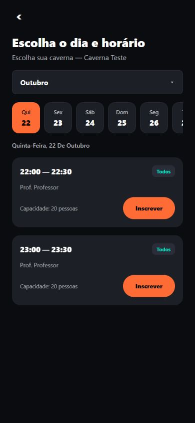

# Testes — Card 88

22/10/2026. Expo SDK 57, RN 0.86.3, React 19.2.3, Node 24 e Bun 1.4.4, versões do lockfile. [SDK 57](https://docs.expo.dev/versions/v57.0.0/) e [Router](https://docs.expo.dev/versions/v57.0.0/sdk/router/) consultados antes das alterações.

## Checks

```sh
bun run lint
bunx tsc --noEmit
EXPO_PUBLIC_API_URL=http://127.0.0.1:30488 bunx expo export --platform web --output-dir .temp/card88-web
```

Lint e typecheck passaram. Exportação web passou com 30 rotas estáticas, incluindo /onboarding/schedule. O primeiro lint detectou atualização síncrona em efeito; a implementação foi ajustada para TanStack Query, sem suprimir regras. Nenhum framework ou runner novo foi configurado.

## Ambiente

App local na porta 8088, navegador em 390×844. API com módulos reais domain/shared/classes/caves/users/practitioners/home na porta 30489, prefixo e ValidationPipe iguais aos do projeto. Postgres 18 em instância isolada 127.0.0.1:55487, banco caverna_card87_test. Sem acesso a banco/site de produção.

Proxy local na porta 30488 encaminha chamadas à API real e permite atraso e falhas controlados externamente. Proxy/fixtures ficam em `.tools` do workspace, fora do repositório/bundle. Fixtures criadas pela API, exceto vínculo de professor, pois não existe endpoint correspondente. Usuário fictício criado pela interface local; nenhuma permissão de localização concedida.

## Fluxo exercitado no navegador

| Caso | Resultado observado |
|---|---|
| Consulta inicial | Duas aulas às 22h e 23h no dia 22/10. |
| Trocar para 23/10 | Lista mudou para aula às 12h. |
| Trocar para 24/10 | Nenhuma aula encontrada, sem popup. |
| Resposta atrasada | Buscando aulas, sem erro/vazio concorrente. |
| Falha simulada 503 | Erro persistente e Tentar novamente, sem anunciar ausência de horários. |
| Retry | Removida a falha, botão exibiu loading e recuperou duas aulas. |
| Caverna inválida | Orientação inline; zero requests com identificador inválido. |
| Escolher outra caverna | Navegou a /onboarding/nearby-gym. |
| Caverna sem unidades | Vazio após consulta bem-sucedida. |
| Troca de mês | Novembro iniciou em 1/11, em vez do dia 10 arbitrário. |
| Ocupação desconhecida | Capacidade: 20 pessoas, sem inventar inscritos. |
| Seleção sem conta | Orientação e Criar conta; nenhum POST de inscrição. |
| Inscrição atrasada | Inscrevendo… no cartão escolhido; ambos botões desabilitados, só um POST registrado. |
| Falha simulada 409 | Permaneceu na agenda, preservou aulas, exibiu erro e liberou botões. |
| Nova tentativa real | API concluiu inscrição e app navegou a /inicio. GET posterior confirmou uma inscrição PENDING. |

Dois POSTs no total: uma falha controlada e uma inscrição real. Apenas uma inscrição persistida; nenhuma chamada concorrente durante envio.

## HTTP real

GET de aulas usou caveUnitId, page=1 e limit=100 do serviço existente. Resposta: HTTP 200, total=3, type=SCHEDULED. Comandos efetivamente usados, com UUID da fixture:

```sh
curl -sS --max-time 10 --noproxy '*' 'http://127.0.0.1:30489/api/v1/classes?caveUnitId=9087e684-cf67-41a1-ab66-f4d9f8e2f3e6&page=1&limit=100'
# HTTP 200; data._meta.total = 3
curl -sS --max-time 10 --noproxy '*' 'http://127.0.0.1:30489/api/v1/classes/516ee590-8452-4e34-b44c-7e85c991a092/enrollments'
# data._meta.total = 1; data.data[0].status = PENDING
```

O payload de inscrição da interface continha somente practitionerId do usuário local. 503/409 dos cenários de recuperação foram controlados pelo proxy, não por falha de produção.

## Evidência e reprodução



Helpers locais: `.tools/card88-server.cjs`, card88-control.json, card88-fixtures.json e card88-requests.json. Para reproduzir com dados equivalentes, iniciar banco/API local, definir EXPO_PUBLIC_API_URL, criar conta fictícia e abrir /onboarding/schedule com cavernaId/cavernaTitle. Testar dias, erro/retry e inscrição. Helpers não são necessários para o funcionamento da aplicação publicada. Servidores e banco temporários encerrados ao final; dados de teste preservados na instância isolada.

## Limites

Validação funcional na web em largura de celular, sem iOS/Android, leitor de tela ou carga. Figma não fornecido. Paginação completa do serviço, nome do professor e ocupação real permanecem para integração; nenhum desses dados é inventado pela tela. Não foi testada a inicialização integral do AppModule, apenas os módulos reais relevantes.
